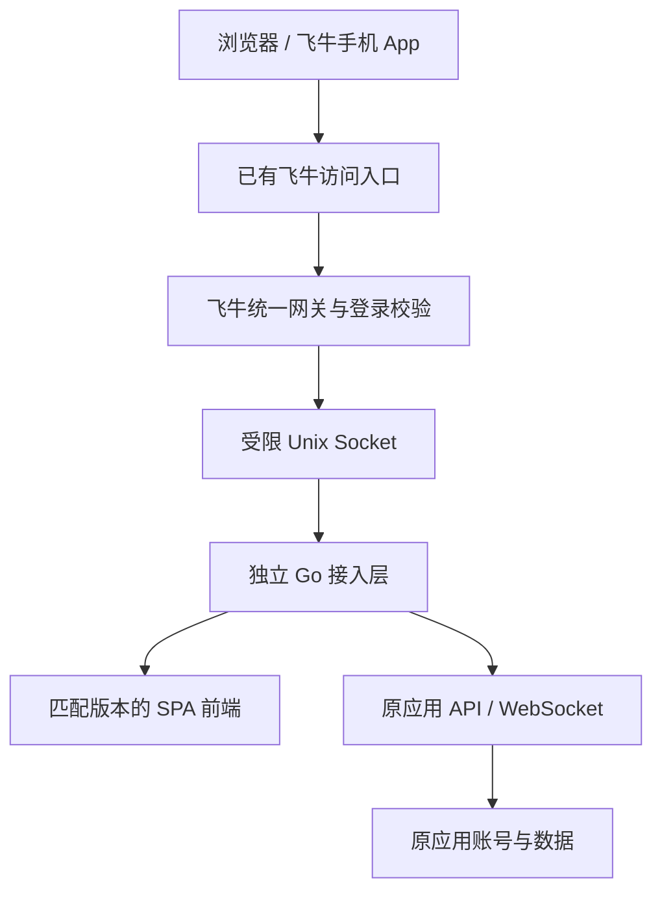

# 飞牛应用入口 · fnos-app-portal

把已有 Docker Web 应用接入飞牛 fnOS 桌面和手机 App，复用已有飞牛访问入口，减少为每个服务单独开放公网反代的需要。

**作者：微信公众号：就是会玩儿**

这是公众号文章配套的通用 AI Skill 工程。除了执行说明，还提供可编译的 Go 接入网关、FPK 工程模板、前端适配接口、测试与验收文档。你可以把整个目录交给 AI，让它先检查你的环境，再完成针对性的适配。

> 本仓库是源码、模板和操作方法，不是适配全部应用的一键安装器。公开模板的验证范围见 [VALIDATION.md](VALIDATION.md)，使用前需要针对自己的 NAS 和应用完成构建与验收。

## 能解决什么问题

- 在飞牛桌面和手机 App 中提供应用图标，从统一入口打开应用。
- 飞牛入口先校验 NAS 登录和用户策略，再保留原应用自己的业务登录。
- 用独立接入包提供前端和代理，不接管原应用的账号、数据库与业务数据。
- 为子路径下的 API、WebSocket、流式响应和文件预览提供适配方法。
- 提供手机布局、域名与内网 HTTP/IP 访问差异等问题的检查方法。
- 将接入层和业务层分开维护，便于后续持续追更应用版本。

它不提供新的公网网络通道。异地访问仍需要你的飞牛入口本身可达，例如已有的域名入口或飞牛远程访问方式。

## 实现逻辑



FPK 负责应用入口、权限、资源及接入层生命周期；Go 网关负责可信转发进程校验、用户策略、路径与来源校验、短租约及代理；前端适配负责应用子路径和客户端行为。原业务服务继续承担自己的鉴权与数据处理。

接入使用独立应用包和容器，不需要修改飞牛底层 Web 服务或自带插件配置。具体接口和信任边界见 [架构说明](references/architecture.md)。

## 两种访问策略要分清

| 策略 | 认证方式 | 需要注意 |
| --- | --- | --- |
| 只保留飞牛入口 | 飞牛登录校验 + 原应用登录 | 必须检查并关闭其他旁路，才能要求所有访问先经过飞牛 |
| 飞牛入口 + 可选内网直达 | 飞牛入口使用两层校验；内网直达仅使用原应用登录 | 直达入口不受飞牛登录或 MFA 保护 |

如需保留原来的内网端口，可以使用 [独立内网转发模板](assets/lan-access)。绑定内网 IP 不等于限制访问来源，仍需核对路由、NAT 和防火墙。

HTTPS 是优先选择。用户明确需要 HTTP/IP 时，模板允许精确的私网 IP Cookie 例外，同时保留 Host、Origin 和用户策略校验；不能全局关闭安全 Cookie，也不能将例外扩展到整个网段。详见 [HTTP 与内网入口](references/http-lan.md)。

## 适用范围与限制

| 项目 | 当前基线 |
| --- | --- |
| 应用形态 | SPA 静态前端，业务 API 位于 `/api/` |
| 业务认证 | `Authorization: Bearer …` / JWT |
| 前端准备 | 使用目标应用的原生配置或独立适配流程构建，本仓库不附带特定应用补丁 |
| FPK 模板 | x86 / Linux amd64 参考基线 |
| NAS 与应用账号 | 相互独立，不自动映射，不构成业务账号 SSO |

网关剥离传入的 Cookie、`X-Trim-*` 和后端的 `Set-Cookie`，防止 NAS 凭据进入业务后端。**依赖业务 Cookie 登录的应用不能原样套用模板**，需要设计明确的 Cookie 允许列表、命名与路径隔离，并增加测试。

自定义 API 前缀、OAuth 回调、绝对重定向、其他 CPU 或不同固件都要先检查兼容性。飞牛同域应用的 XSS、宿主 root 和 Docker 管理权限属于额外信任边界；统一入口不能代替业务安全修复，也不代表“绝对安全”。

## 怎么交给 AI 使用

无需安装到本机 Skill 发现目录，也无需放入原业务项目。将仓库克隆到一个独立目录：

```bash
git clone https://github.com/muyecc/fnos-app-portal.git
```

然后把实际目录路径和下面的提示词交给具备文件读取、开发、浏览器及 NAS 管理能力的 AI：

```text
请阅读 fnos-app-portal 目录中的 SKILL.md，以及其中按任务引用的材料。

我的目标是：把现有 Docker Web 应用接入飞牛桌面和手机 App，
复用已有飞牛入口，并保留原应用业务登录。

先只读核对 NAS、容器、应用版本、访问地址、持久化和认证方式。
先文字说明模块职责、需要改动的部分、兼容性风险和后续升级方式。
不要修改飞牛底层、自带插件或其他应用；不要导出或公开凭据。

请确认我选择的是“仅飞牛入口”还是“另保留内网直达”，
然后根据我授权的范围实施和验收。需要我登录时让我自行操作，
不要索取密码或验证码，不要把本地构建当作已经部署成功。
```

实际工具和权限由所用 AI 环境决定。仓库不会自动连接 NAS、安装应用或修改系统；没有可靠管理通道时，应先交付本地方案和构建物。

## 实施流程

1. **建立基线**：检查目标 NAS、现有容器、镜像、挂载、可写层、端口和真实转发进程身份，不直接照搬示例参数。
2. **确认访问策略**：明确允许哪些 NAS 用户进入，以及是否保留内网直达；按需读取相关文档。
3. **准备独立工作目录**：复制 [计划示例](references/plan.example.json)，填写目标环境参数。只有实测确认 peer UID 后才能标记 `peer_uid_verified`。
4. **构建匹配前端**：按 [通用接口](references/frontend.md) 核对原生子路径能力、API/WS 和登录机制，完成浏览器租约续验、目标项目测试及构建，生成前端 manifest；本仓库不提供一键转换任意前端的脚本。
5. **构建接入项目**：使用 `render_project.py` 渲染，再运行 `build_gateway.py`。先检查各脚本的 `--help`，并使用 `--dry-run` 核对输入。
6. **准备镜像与 FPK**：按 [打包说明](references/fnos-package.md) 构建镜像，再用 `build_package.py` 调用官方 `fnpack`。本地有镜像不代表 NAS 已经有镜像。
7. **隔离测试后上线**：使用独立 Compose project/service 标签验证，通过飞牛原生应用中心安装或更新接入包。
8. **真实客户端验收**：检查电脑和手机、匿名拒绝、伪造身份拒绝、API、WebSocket、文件预览、流式响应和真实退出后的连接回收。

完整命令和完成标准以 [SKILL.md](SKILL.md) 与 [验收说明](references/acceptance.md) 为准。`check_entry.py` 只验证无凭据或伪造身份的拒绝情况，不能代替真实登录验收。

## 开发与构建依赖

- Python 3.10+：计划渲染、来源校验、打包辅助和入口检查。
- Go 1.24+：网关构建与测试。
- 目标应用的前端工具链：需要构建时按上游要求准备，例如 Node.js / npm；本仓库不固定某一种框架或构建器。
- Docker：构建镜像及 Linux 隔离测试。
- 官方 `fnpack`：FPK 打包。
- 已有的 NAS 管理与浏览器工具：用于授权范围内的检查、部署及验收。

Windows 下可用 `py` 代替 `python`，路径和换行按 PowerShell 语法调整。Windows 普通测试不能代替 Linux 上的真实 Unix peer 校验。

可在仓库根目录运行 Python 工具测试：

```bash
python -m unittest discover -s scripts -p 'test_*.py'
```

网关测试在 `assets/portal` 目录运行：

```bash
go test ./...
go vet ./...
```

## 目录与阅读入口

| 路径 | 内容 |
| --- | --- |
| [SKILL.md](SKILL.md) | AI 执行入口、任务路由、构建步骤与操作边界 |
| [references/architecture.md](references/architecture.md) | 数据流、接口、认证与信任边界 |
| [references/fnos-package.md](references/fnos-package.md) | FPK、权限、资源与生命周期 |
| [references/frontend.md](references/frontend.md) | 通用子路径适配、浏览器租约和前端产物接口 |
| [references/http-lan.md](references/http-lan.md) | HTTP/IP 兼容与可选内网直达 |
| [references/acceptance.md](references/acceptance.md) | 验收清单与故障定位 |
| [references/release.md](references/release.md) | 发布、升级与公开交付边界 |
| [assets/portal](assets/portal) | Go 网关、测试、Dockerfile 与 FPK 模板 |
| [assets/lan-access](assets/lan-access) | 可选独立内网转发模板 |
| [scripts](scripts) | 准备、渲染、构建、打包和检查工具 |
| [VALIDATION.md](VALIDATION.md) | 发布前已做的验证及未覆盖范围 |
| [SHA256SUMS](SHA256SUMS) | 本次发布文件的 SHA-256 清单（不含清单自身） |

## 后续怎么追更

业务版本和接入版本分别记录。每次更新先核对上游 commit、归档 SHA-256、镜像来源和前端变化，再在新目录使用目标项目的配置或适配流程。维护补丁时应校验目标版本和变更位置，检查失败先审查差异，不删除校验强行构建。

前端必须匹配后端版本，原有能力不能因上游镜像功能变体或打包方式变化而丢失。网关、权限、启动配置或上游版本变化时，走预检后的 FPK 原生更新。所有临时测试项目要与生产隔离，升级不应通过整机重启或卸载重装来完成。

备份策略按使用者要求执行；不备份也不能忽略容器可写层里的运行数据。更多细节见 [发布与长期追更](references/release.md)。

## 验证状态与问题反馈

通用网关和辅助工具的验证记录见 [VALIDATION.md](VALIDATION.md)。**目标应用的前端构建、FPK 打包和真实 NAS 部署验收需要在各自环境完成，不能由模板测试代替。**

反馈问题时请提供脱敏后的应用版本、NAS/CPU 信息、访问方式、失败步骤及相关错误，不要上传 OAuth profile、令牌、真实 `.env`、数据库、业务上传文件、完整容器 inspect 或私有镜像。
